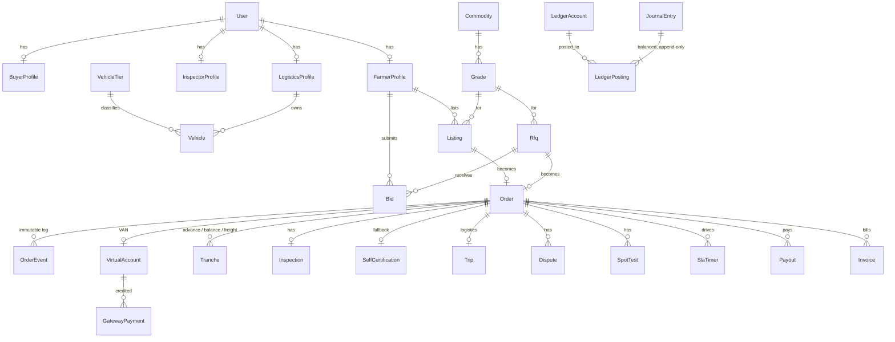
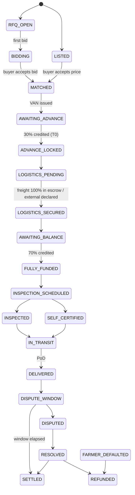

# Agrimate — Build Plan

B2B agri-trade platform: Buyers ↔ Farmers/FPOs, Agri-Inspectors, Logistics partners, RBI-compliant escrow
(Razorpay Smart Collect + Route). Assumptions and open questions live in [DECISIONS.md](./DECISIONS.md).

## 1. Monorepo layout

```
apps/
  api/            NestJS modular monolith (REST + OpenAPI, BullMQ workers in-process)
  web-buyer/      Next.js 15 buyer portal            :3000
  web-admin/      Next.js 15 ops console             :3001
  pwa-farmer/     Next.js 15 PWA (en/hi/as/bn)       :3002
  app-inspector/  Expo (Android-first)
  app-logistics/  Expo (low-bandwidth)
packages/
  shared/         enums, money, pricing, grade helpers, name-match, validators, state machines, view types
  api-client/     generated OpenAPI types + typed fetch client
  ui/             shared Tailwind/shadcn-style components
infra/            docker-compose, Dockerfiles, env templates
```

API modules: `core` (prisma, clock, crypto, audit, config) · `auth` · `adapters` (payments, maps, market-data, sms, kyc,
storage) · `masters` · `files` · `onboarding` · `marketplace` · `orders` · `payments` · `ledger` · `settlement` · `sla` ·
`inspection` · `logistics` · `disputes` · `market-data` · `notifications` · `admin` · `health` · `dev` (mock bank, mock mode only).

## 2. Data model (ERD)



Rules: all money is integer paise (`BigInt`, serialised as strings in JSON). Quantities are integer kg. Percentages are
basis points. Commission/fee/SLA values are **snapshotted on the order** so an admin config change never rewrites a live
contract. PII (phone, PAN, bank) is AES-256-GCM encrypted with HMAC blind indexes for lookup.

## 3. State machines (table-driven, `packages/shared/src/state-machine.ts`)



RFQ and Listing have their own small machines; an `Order` row is created at `MATCHED` and both flows converge.
Failure branches: `FARMER_DEFAULTED → REFUNDED`, `BUYER_DEFAULTED → REFUNDED|CANCELLED`, `CANCELLED`. Every transition writes
an immutable `OrderEvent` (DB trigger blocks UPDATE/DELETE); illegal transitions return **409**.

## 4. Money flow (double-entry)

| Event | Debit | Credit |
|---|---|---|
| Tranche credited | `gateway_nodal` | `buyer_escrow:{order}` |
| Gateway fee on credit | `gateway_fee` | `gateway_nodal` |
| PoD freight release | `buyer_escrow:{order}` | `logistics_payable:{p}` + `platform_freight_markup` |
| Settlement | `buyer_escrow:{order}` | `farmer_payable:{f}` + `platform_commission` + `inspection_fee` |
| Negative-balance offset | `farmer_payable:{f}` | `farmer_receivable:{f}` |
| Inspector accrual | `inspector_cost` | `inspector_payable:{i}` |
| Payout | `*_payable` | `gateway_nodal` |
| Platform sweep | `platform_cash` | `gateway_nodal` |
| Refund | `buyer_escrow:{order}` | `gateway_nodal` |
| Default fee recovery | `farmer_receivable:{f}` | `gateway_fee` |

Ledger is append-only and each journal sums to zero (enforced by a deferred DB constraint trigger as well as in code).

## 5. API surface (prefix `/api/v1`, Swagger at `/docs`)

- `auth`: `POST otp/request`, `otp/verify`, `login`, `refresh`, `logout`, `GET me`
- `masters`: commodities, grades, vehicle tiers, inspection tiers, config, contract terms, pincodes (admin writes)
- `files`: `upload-url`, `:id/complete`, multipart (`:id/parts`, `:id/multipart-complete`), `:id/download-url`
- `onboarding`: `buyer/kyb`, `farmer/kyc`, `inspector/degree`, `inspector/availability`, `logistics/profile`, `logistics/vehicles`, `organic-certs`
- `rfqs`, `rfqs/:id/bids`, `bids/:id/accept`, `listings`, `listings/:id/accept`
- `orders`, `orders/:id`, `orders/:id/events`, `orders/:id/freight-quote`, `orders/:id/logistics/{platform,external}`, `orders/:id/depart`, `orders/:id/confirm-delivery`, `orders/:id/deviation/accept`
- `webhooks/razorpay`
- `inspector/jobs`, `inspections/:id/{check-in,grading,mark-inspected,cancel}`
- `self-cert/:orderId/{session,clips,submit}`
- `trips/available`, `trips/mine`, `trips/:id/{accept,eway-bill,pickup,deliver}`
- `disputes`, `orders/:id/disputes`, `orders/:id/spot-tests`, `spot-tests/:id/result`
- `market/prices`, `market/suggestion`
- `ledger/me`, `payouts/me`, `orders/:id/invoices`, `invoices/:id/pdf`
- `admin/*`: review queues, orders explorer, disputes, ledger explorer, refunds, audit log, SLA board, inspector override, reconciliation
- `health`, `metrics`; `dev/mock-bank/*` (mock mode only)

## 6. Phase checklist

Backend is built in the prompt's phase order, with UI work following once the API contract is stable (all portals
consume the same generated client). Each phase is committed separately.

- [x] **1 Foundation** — monorepo, Docker, Nest skeleton, Prisma schema, auth, shared package, seed
- [x] **2 Masters & onboarding** — commodity/grade, tiers, fee config, KYC/KYB/degree/vehicle flows, review queues
- [x] **3 Marketplace** — RFQ, bids, listings, matching, phone unlock
- [x] **4 Escrow & ledger** — Razorpay adapter + mock, VANs, webhooks, ledger, tranches, settlement, refunds, negative balance, reconciliation
- [x] **5 SLA & inspection** — BullMQ timers, auto-assign, inspector flows, self-certification
- [x] **6 Logistics** — freight, booking, trips, E-Way bill, PoD, freight payout
- [x] **7 Quality & disputes** — shrinkage guard, organic spot tests, dispute workflow
- [x] **8 Market data** — Agmarknet adapter, daily cron, suggestions
- [x] **9 Notifications** — SMS/OTP adapters, outbox, SLA alerts
- [x] **10a Portals** — buyer, admin, farmer PWA (i18n), inspector app, logistics app
- [x] **10b Hardening** — Section 10 acceptance suite, security review, README, OpenAPI, deployment notes
